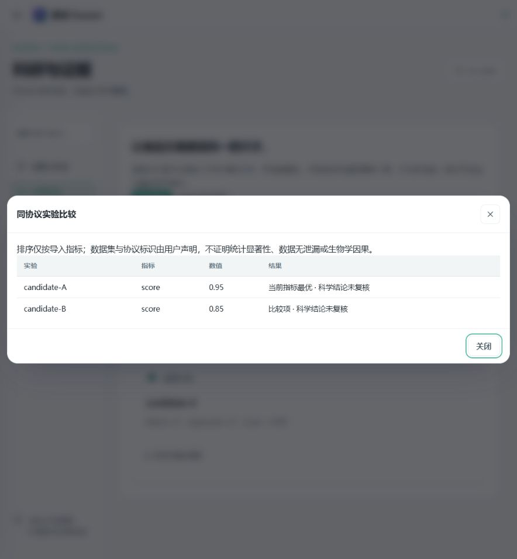
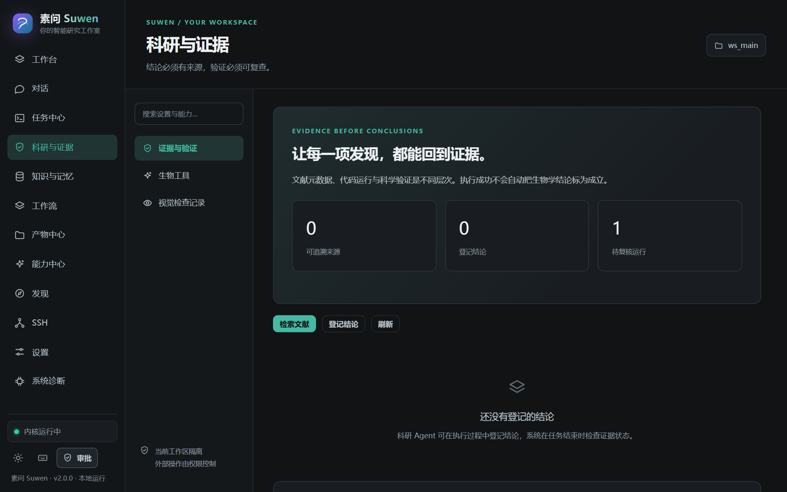

一个常见的场景是：让 Agent 跑一段分析，日志显示成功，图也生成了；你问它结论能不能写进报告，它回答得很流畅。问题在于，这份流畅与「结论成立」之间，往往隔着一整条没人检查的路。

素问 Suwen 2.1.0 想解决的就是这段距离。它在 2026 年 10 月 24 日发布，是 ForrestGump618 维护的一个本地优先 AI Agent 工作室，Apache-2.0 开源，定位是「在你的本机目录或 SSH 主机目录里写代码、跑 Python、读写文件、提交长任务，并把科研结论纳入一条可审查的证据链」。

如果只看功能列表，这类项目很容易读成又一份「Agent 工作台」的清单：对话、工具、技能、MCP、工作流、多模型。但把 2.1.0 的更新日志和升级说明连着读完，会发现这一版的重心其实很窄——四个变化都围绕同一件事：把「执行」和「验证」拆成两层，并且交代清楚这两层各自走到了哪一步。

这篇文章不打算复述功能清单。下面提到的每一条能力、每一个数字、每一处「部分实现」，都来自素问仓库里的 README、CHANGELOG 与 docs（升级说明、实现清单、验证记录）；凡是项目自己标注为未验收的地方，这里也照实写出来。

## 一、它是什么：一个跑在本机的 Agent 工作区

服务默认只监听 `127.0.0.1`，没有登录、没有租户、没有遥测；会话、事件、产物与快照以 SQLite、JSON、Markdown、PNG 的形式落盘。Web UI 是纯静态的原生 ES Modules 单页应用，没有构建步骤、没有 CDN，一共 20 个页面路由（12 个侧栏页面加 8 个工作台内部面板）；服务端是 FastAPI。对使用者来说，最直接的区别是：你的数据目录本身就是可读、可复制、可备份的文件夹，而不是某个远端账号里的一团黑盒状态。

工作台把对话、变量浏览器、文件、图表、任务与终端放在同一个作用域里，共享同一份内核状态。这一点在反复分析数据时很实用——不必每轮重新读一遍数据，也不必在「分析」和「调试」之间切换工具。


更值得注意的是它的运行模型。每一回合是一次 run（带 `run_id` / `trace_id`），事件先写入 SQLite（WAL，schema v3）再向浏览器广播；SSE 断线可以按 `after_seq` 重放（上限 5000 条，超出会明确提示 `stream_gap`），空闲 15 秒发一次心跳。进程崩溃或重启后，未完成的 run 会被对账为 `interrupted`（`meta.recovered=true`），而不是伪造成完成。


「持久任务中心」把这条线延长到任务级：SQLite 队列、暂停 / 取消 / 恢复、节点 Checkpoint、DAG 依赖与并行、幂等键、超时与重启标记；可视工作流是可拖动的 DAG，节点包括模型、工具、条件、并行、审批与输出，模板可以保存并反复运行。另有 23 个内置技能、13 个内置智能体（都是带 frontmatter 的 Markdown，可按工作区覆盖，默认只把目录注入上下文、正文按需读取）、17 个内置工具，以及按工作区 / Agent 生效的 `allow` / `ask` / `deny` / `read_only` 权限策略；审批记录持久化，拒绝结果会回填给模型。

模型接入是显式配置的：14 个 Provider（含本地 Ollama 与离线 `mock`），快速 / 均衡 / 深度三种模式，文本、推理、代码角色可以分别路由；密钥存在 `auth.json`（Windows 上用 DPAPI 加密），API 只返回 `has_key` 之类的布尔值。工作区既可以是本地目录，也可以是 SSH 主机上的某个远端目录；远端不可达时明确抛出 `BackendUnavailable`，禁止静默回退到本机执行。

扩展入口按同样的方式落地：能力中心可以接入 MCP 服务（支持 stdio 与 Streamable HTTP，协议版本 2025-06-18，可配可选 token），工具列表会标注是否只读、是否有副作用，配置变化后自动重载；消息渠道提供 WebChat 与 Telegram 等适配器；知识库与长期记忆跨窗口、跨会话持久化，并把相关记忆注入对话。渠道部分在 2.1 的清单里仍被标为「部分实现 / 外部依赖限制」——微信、飞书、QQ 适配器本包未实现，Telegram 也没有在真实账号上验收过。

需要提前说明定位：它是单机、单用户项目，没有内置登录与鉴权，默认只监听回环地址；文档明确写着不要把它暴露到公网或多用户共享机器上。

> 图片来源说明：文中截图取自素问仓库 `docs/screenshots/`，界面右下角标注仍为 v2.0.0；2.1.0 的界面变化集中在设置选项与工作流节点上，下文那张实验比较弹窗是该版本的验收截图。截图均以 Apache-2.0 许可随仓库发布。

## 二、2.1.0 究竟新增了什么

官方升级说明的标题是「把编排和验证放进执行过程」。把这个版本拆开看，是四个具体功能，以及它们各自的「不做什么」。

### 1. Sage-A1.5 自检：一个默认关闭的选项

「设置 → 智能模型」里增加了两个默认关闭的选项，其中一个是 Sage-A1.5 自检。它的实际行为是：对模型名称包含 `Sage-A1.5` 的请求，传递 `chat_template_kwargs.verification=true`。也就是说，它不是平台内置的一套「自我批评提示词」，而是一个协议开关——背后需要有一个兼容的实际模型服务，其他模型与备用模型不会收到这个参数。

参考对象是 Sage-A1.5 的官方模型卡与 2026 年 10 月的技术报告；项目也明确表示，不把它称为 InternAgent 1.5 的完成版。文档里把话说得很清楚：参考的是其并行协作、自检与可检查研究产物的组织方式；适配不等于重新训练了书生模型，也不继承上游的评测成绩。权重、GPU 环境与推理服务由使用者自备；本轮没有下载权重，也没有在真实 Sage 服务上完成质量评估。

最重要的一句边界是：自检属于模型自己的推理过程，素问的文件指标检查与人工科学复核是另外两层，不会因为模型自检或多模型共识就自动通过。

### 2. 并行子任务：把并发限制写进说明里

另一个默认关闭的选项是并行子任务。它暴露 `spawn_subagent` 工具，按输入顺序返回结构化研究结果。每个子任务必须提供 `task`、`context`、`expected_output` 三段说明；子任务不会获得父会话全文，当前实现沿用父 Agent，避免通过任意切换角色扩大权限。

限制写得很具体：批次最多 5 个，且进一步受原有 `max_child_tasks` 限制（默认 4），超限会被拒绝而不是静默丢弃；并行任务只共享经显式授权的工作区，各自有独立会话，但计算工具仍然使用该工作区的共享内核并串行访问——需要彻底隔离文件或变量时，应该换用不同工作区。

返回记录包含 `answer`、`status`、`evidence` 与 `unresolved_issues`。结果不是有效 JSON 时标为 `unknown`，来源 ID 不存在于当前工作区时标为 `insufficient_evidence`。文档里还有一句容易被忽略的话：`completed` 仅表示回答完成，`scientific_status` 仍是 `unverified`；来源存在，也不代表引文支持了论断。

### 3. 指标验证节点：让文件里的数字有权拦住流程

工作流里新增了 `verify` 节点，配置长这样：

```json
{
  "id": "validate",
  "type": "verify",
  "depends_on": ["analysis"],
  "path": "results/metrics.json",
  "rules": [{ "metric": "validation_score", "op": "ge", "threshold": 0.8 }]
}
```

节点从所选本地或 SSH 工作区读取实际 JSON，记录内容 SHA256 和逐项检查结果；缺少指标、非有限数值或检查失败，会停止后续依赖步骤，并在节点中保留失败原因。修正数据或方案后，需要检查外部操作状态再恢复任务，已完成节点不会被重放。比较运算符只支持 `lt` / `le` / `gt` / `ge` / `eq`，不执行任意判断表达式。

「验证节点不是统计学审稿器，也不会自动改写分析代码。」这句同样来自文档。循环节点、自动策略进化与湿实验接口，仍在后续范围中。

### 4. 实验比较与可交换流程：把「可复现」往前挪一格

「科研与证据 → 实验比较」的做法是：运行分析并保存 JSON 指标后，登记名称、数据集版本、协议版本、文件路径、目标指标与优化方向；选中至少两项实验，系统只比较这些标识都相同的记录，并保留并列最优项。

这里的关键词是「导入的计算指标」，不是平台重新执行过的 benchmark。数据集与协议标识由用户声明，指标文件摘要由平台实际计算；因此不能据此排除数据泄漏、混杂，也不能证明显著性。验收截图里那句提示写得更直白：排序仅按导入指标，不证明统计显著性、数据无泄漏或生物学因果。



同版本还补了工作流的 JSON 导入与导出：导入先检查 Schema、节点与依赖，生成新的模板 ID，不立即执行；导出采用脱敏处理，含凭据的原始参数可能变成占位值，导入后需要检查并重新配置。对外的接口是四个：

| 接口                                                | 用途                                               |
| --------------------------------------------------- | -------------------------------------------------- |
| `GET/POST /api/platform/experiments?scope=...`      | 查看或登记实验指标                                 |
| `POST /api/platform/experiments/compare?scope=...`  | 请求体 `{"ids": ["experiment_a", "experiment_b"]}` |
| `GET /api/platform/workflows/{id}/export?scope=...` | 导出 Schema 1 模板                                 |
| `POST /api/platform/workflows/import?scope=...`     | 导入 `schema_version` 与 `workflow`                |

## 三、它自己承认的边界，恰恰是最值得读的部分

在「24 类 V2 需求」的实现清单里，只有品牌与多级设置两项标为「已实现」，其余是「部分实现」或「部分实现 / 外部依赖限制」。清单开头定义了四个状态词：已实现表示有实际后端和可用操作；部分实现表示已有可用子集；待实现表示本包未提供；外部依赖限制表示需要用户环境、凭据或上游服务。清单末尾还有一行提醒：不要把「部分实现」改成「全部完成」，除非相应子项有实际代码与验收证据。

这份清单本身比大多数发布说明更有信息量。例如：真实 SSH 端到端、真实付费模型 / 视觉 / 嵌入、Docker 容器、Telegram 与 OAuth 授权、上游科研环境都还没有完成外部验收；Docker 沙箱只对显式选择的 Python 工具生效，常规的本机 Python / Shell 仍然等价于当前操作系统用户权限；项目不宣称彻底防御提示注入；团队 RBAC 与多用户强隔离未实现；macOS / Linux 安装脚本虽然提供，但维护者没有对应主机、尚未实测。

还有一个我认为很罕见的句子：维护者的验证中没有使用付费模型做真实研究，因此项目不提供任何新的生物学结论。换成产品语言，这句话并不「好看」；但作为使用者，你会因此更清楚该把哪些输出当作参考、把哪些当作需要自己复现的线索。

测试与验证的部分也按同样的口径写：`python -m pytest -q` 在 Windows 加 Python 3.12.11 上是 446 passed、约 35 秒；CI 在 Ubuntu（3.10 / 3.11 / 3.12）与 Windows（3.12）上跑同一套测试，测试完全离线、模型使用 `mock`。新增检查覆盖批次限制、并发、来源 ID、结构化输出、父任务工具权限上限、指标门控失败与恢复、跨协议比较拒绝、模板校验与 Sage 参数隔离；但外部模型测试使用协议替身，不能代替真实模型验收。

而且，2.1 并没有把清单里那些「没完成」变成「完成」：团队权限、完整渠道适配和科研训练体系仍然没有因此变成已完成。发布说明里这句话写得很直接，我认为这是判断一个项目成熟度的好信号——它知道自己的版本号应该对应什么。

## 四、证据链如何运作：五件小事拼成一条路

科研与证据页上有一行小字：结论必须有来源，验证必须可复查。支撑这句话的是一组轻量工具：`bio_literature_search` 实际请求 Europe PMC 并保存标题、摘要、DOI、PMID、URL、检索时间与撤稿标志；`bio_protein_lookup` 请求 UniProt 并保存登录号、基因名、物种、注释与来源；`bio_sequence_check` 在本地做确定性的序列检查（长度、GC、模糊碱基、反向互补，全 N 序列返回空比值，非法碱基会被标注）；`bio_record_claim` 把结论分成证据、推断与假设，并要求引文指向当前工作区里真实存在的来源记录；`bio_verify_claim` 读取真实 JSON 指标文件，按有限数值做数值比较，与模型意见无关。



流程是：检索公开来源 → 按权限执行分析代码 → 记录代码、参数、输出摘要与来源 → 登记证据 / 推断 / 假设 → 读取实际指标并独立检查 → 人工科学复核。数值检查通过，最多得到 `checks_passed_needs_human`；来源不足或检查失败记为 `insufficient_evidence`；未完成人工复核的科研运行会停在 `needs_review`。人工复核要求署名、理由、有效来源与无失败检查，而且模型与工具无权自动签署复核——`human_reviewed` 只代表本机使用者签了字，不代表独立专家背书。

这套设计并不新潮，甚至有点笨：笨在每一步都要留痕，笨在它拒绝把「代码跑通」翻译成「结论成立」。但对需要把分析写进论文、周报或结题材料的个人研究者来说，笨办法往往才是能复查的办法。

## 五、工程层面的几个硬边界

文档里还有一组不显眼、但对使用者影响直接的约束。数据目录默认在 `~/.omicslab`，事件是只追加的账本，写入采用先落盘再通知的方式；配置与记忆保持人类可读的格式，便于迁移与手工检查。并发与取消有明确数值：`max_parallel_runs` 默认 8、`max_child_tasks` 4、`max_child_depth` 2；取消会沿链路级联，给 15 秒宽限后收尾，超时则标记为 `interrupted`；SSH 远端 worker 的请求超时为 900 秒，`ssh_exec` 默认 120 秒、最大 3600 秒。这些数字不惊艳，但它们决定了跑长任务时系统是会卡死、还是会给你一个可解释的失败。

产物侧同样有限制：快照上限 10MB，超过只记录截断状态；任意 Python / Shell 直接写出的文件不会逐文件进入快照，恢复时可能需要重新生成。工作区里其实有两层「沙箱」——路由级的路径沙箱会拦截 `../` 逃逸和指向工作区外的绝对路径，但默认的本机执行仍然等价于当前系统用户权限；真正的文件与网络隔离要交给可选的 Docker 执行后端，而 Docker 也没有随版本完成真实容器验收。

## 六、谁适合用，以及怎么开始

适合的使用者：需要在本机或远程服务器上反复做分析的个人研究者、学生与小团队，以及希望把文档、数据与执行记录留在一个工作区里的开发者。它不适合两类场景：直接当公网多租户服务，或者把临床、生产环境的执行权限直接交给它。

启动方式很短：Windows 上执行 `scripts/bootstrap.ps1`（需要生物分析库时追加 `-Extras "bio"`），再用 `启动工作台.ps1`，默认地址 `http://127.0.0.1:8766`；也可以 `pip install -e .` 后 `python -m omicslab serve`，CLI 默认端口 5077。`python -m omicslab env`（别名 `doctor`）做健康检查。第一次使用三步：配置模型（暂时不接真实模型也可以先用 `mock` 离线走通流程）、建工作区、在工作台里直接提任务。项目以 Apache-2.0 发布，引用方式见 `CITATION.cff`。

还有一个容易被忽略的成本事实：项目本身没有充值、计费和托管密钥，模型费用与额度全部由使用者自己的 Provider 承担；`mock` 与离线模式只用于验证流程，不能当作模型能力或科研质量的评估。

## 写在最后

读完 2.1.0 的文档，我最强的感受不是「功能又多了」，而是它把「我知道自己不知道什么」写进了产品里：哪些能力有实际后端、哪些只是入口、哪些依赖你的环境、哪些需要人来签字，全部摊在清单上。

AI Agent 工作台这个品类，眼下最不缺的是能力演示。稀缺的是另一种克制：在模型说「已完成」的时候，系统仍然坚持问一句——证据在哪、谁复核过、能不能重跑。素问 2.1.0 的四个新增功能，本质上都在回答这三个问题的一部分。它离完整答案还很远，但它至少没有假装已经到达。

---

**事实与来源**：本文依据素问仓库 v2.1.0 的 `README.md`、`CHANGELOG.md`、`docs/UPGRADE-2.1.md`、`docs/SUWEN-V2-CHECKLIST.md`、`docs/VALIDATION-V2.md`、`docs/BIOMEDICAL-EVIDENCE.md` 与 `docs/ARCHITECTURE.md` 撰写；截图均来自仓库 `docs/screenshots/`，以 Apache-2.0 许可随项目发布。文中数字与状态均为文档口径，未做额外实测，也不构成对任何生物学结论的背书。
