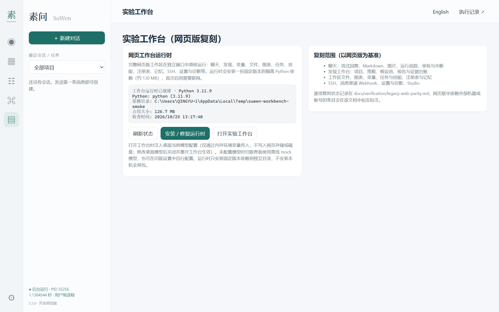
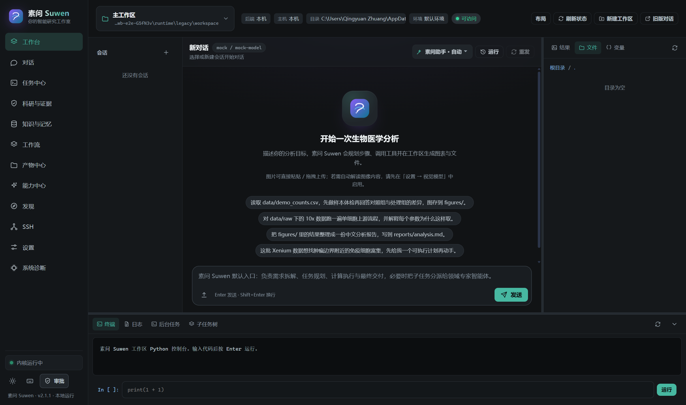
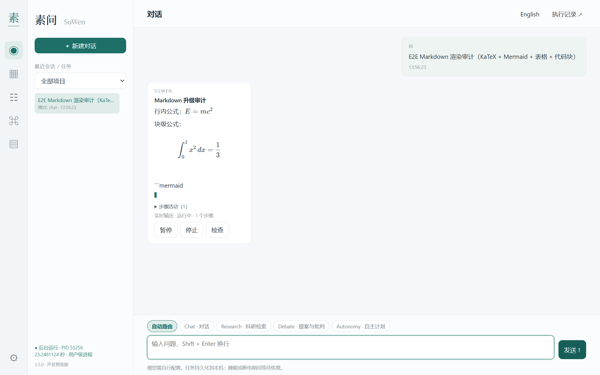
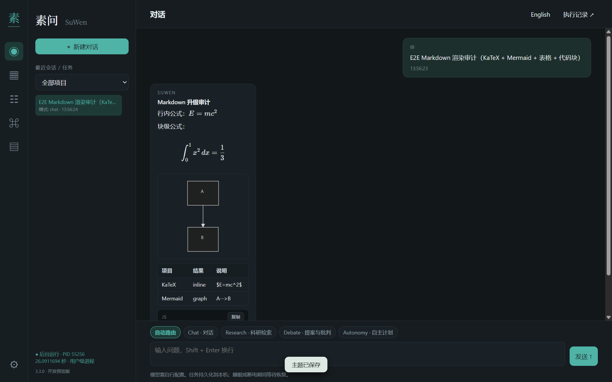
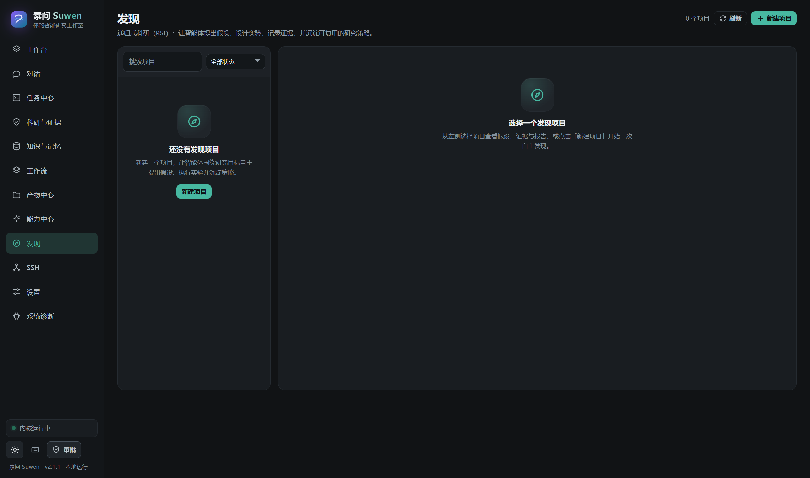

上一篇写素问 2.1.0，还是网页版产品线。之后这几个月，项目其实一直在做另一条线：把整套东西搬进 Windows 桌面，用 Electron 加一个独立的后台守护进程重写执行层，内部叫 vNext。3.3.0 是这条线的第六个预览版。

上一版有个很实际的问题。桌面端只有五个原生页面，网页版里真正干活的那些界面——发现、文件、图表、内核、SSH、诊断——要么看不到，要么得等一个依赖旧 Python 环境的兼容窗口，而那个窗口在我机器上经常打不开。另一个问题更直白：聊天里的 Markdown 一直是纯文本，公式和流程图都退化成代码块，流式输出时整段消息要等回答结束才排版。两件事叠在一起，就是“桌面端缺东西”的感觉。

3.3.0 主要补这两块。

## 网页版没重写，原样搬了进来

网页版是素问 2.x 的产品界面，原生 ES Modules 写的单页应用，20 条路由、14 个视图模块，对话、发现、文件、图表、任务、技能、注册表、记忆、SSH、设置和诊断都在里面；最大的是对话页，96 KB 的 JS。

我一开始试的是另一条路：在桌面端写一个兼容层，把网页版需要的接口映射到新的存储和执行层。试了几个页面就放弃了——网页版的视图代码对返回结构卡得很死，字段少一个就渲染空白，而它引用的接口有上百条，逐条对齐的工作量和重写一遍差不多，回归测试也没法复用。

最后选的方案是托管。桌面端加第六个工作区“实验工作台”，由它管理一个隔离的 Python 运行时，在独立窗口里打开原来的网页界面。窗口里跑的 HTML、CSS、JS 和网页版完全一致，所以布局、交互、快捷键都不用重新适配；差别只是请求发给了桌面端管理的本地运行时，而不是用户自己启动的服务器。

运行时没有塞进安装包，首次打开时按需安装。13 个顶层依赖的版本固定在 `workbench.ts` 里，约 130 MB，界面会提前写明大小和联网要求。依赖目录里放一个标记文件，记录依赖哈希、Python 小版本和安装时间；Python 变了、依赖清单变了，标记就失效，需要重新校验或者修复。这个设计不复杂，但比“悄悄 pip install 到全局环境”可控得多。

隔离做了几层：随机回环端口、每个窗口单独的 Bearer 令牌、只给该窗口注入 Authorization 头、禁止 `window.open` 和站外导航、页面里没有 Node 和 preload。桌面端配的模型与密钥在打开窗口时通过环境变量传进去，只存在于桥接进程内存里，不写入网页版存储，也不落盘。代价是改了模型要关掉窗口重开才生效，这一点在页面提示里写清楚了。

调试这段时踩的坑比预想多。最典型的一个：网页版默认主题是“跟随系统”，我的系统是浅色，于是托管窗口第一次打开永远是白的，和原版深色界面对不上。修法是首次运行时往它的 platform 存储里写一条深色默认值；写完仍然报 `KeyError: 'value'`，查了半天才发现记录结构必须是 `{"value": {"theme": "dark"}}`，少包一层就会被读配置的代码当成坏数据。还有一次，打包后的应用启动后立刻退出，查到最后发现是开发用的 shell 继承了 `ELECTRON_RUN_AS_NODE=1`，Electron 把主窗口当成 Node 脚本跑完了。

## Markdown 终于不是纯文本

流式渲染换成了“稳定前缀”的方案：已经闭合的段落、代码块、表格、公式先排版；正在输入中的代码围栏、表格或公式保持原文，等闭合后再切换。重建节奏 110 ms，实测 10,000 字符、500 次增量，排版总耗时 42–44 ms，输入框和滚动位置不跟着跳。

公式用离线内置的 KaTeX 0.16.21（带字体），流程图用 Mermaid 11.12.0，两者都随应用打包、懒加载、按时间片执行，不联网也不走 CDN。安全上 `script-src` 仍然是 `'self'`，不执行 HTML；Mermaid 用 `securityLevel: strict`，解析失败退回带标注的代码块。为了让两者的内联样式生效，样式来源放开到了 `'unsafe-inline'`——这是明确的取舍，写进了安全评审，也留了“只显示源码”的回退方案。托管网页版那边后来也遇到同一个问题：Mermaid 在页面里生成 SVG 时被 CSP 拦掉 120 次，最后用同样的方式放开内联样式，才算把图正常画出来。

## 验证做到哪一步

这些数字都是本机 Windows 11、Node 24.14、Python 3.11.9 上跑出来的，不是估算。

托管窗口的 Electron E2E 过了 34 项，12 条主路由真实渲染，留下 19 张截图，页面错误、控制台错误和 CSP 违规都是 0；流式过程中已闭合的公式已经排版，未闭合的 Mermaid 围栏保持原文。桥接运行时的 smoke 27 项全过，覆盖 SPA 资源、未认证接口返回 401、19 个 API、新建会话与 run、干净关闭；模型配置注入 13 项，确认 provider/model/base URL 能传进托管进程，改配置后桥接会重启。

Markdown 单元测试 32 项。桌面端全量测试 222 项，220 通过、0 失败、2 跳过（Windows 符号链接权限和可选的旧版 Python 依赖）。RPC E2E 42 项，其中包含真实的 Europe PMC / PubMed 和 UniProt 请求；故障注入 12 项，覆盖 worker 与 daemon 被 kill、取消、provider 连续报错。安装生命周期 12 项，包括从 3.0.0-preview.1 升级到 3.3.0。

GitHub Actions 上跑同样的桌面构建和测试，最近三次提交都是两个 job 全绿。第一次变绿之前失败过一次，是一个旧版 Python 的时序测试在 Windows runner 上偶发超时，重跑后通过；这件事也记在发布说明里，没有藏起来。

## 还没做完的

安装包没有代码签名，Windows SmartScreen 会提示；干净 Windows 虚拟机上的安装流程还没跑过，目前只在宿主环境验证了安装、启动、升级、卸载。

8/24/72 小时的长时运行、重启、断电、睡眠、磁盘满这些场景都没测，只有短时故障注入和一次 25 分钟的加速 soak。真实厂商模型账号、真实 SSH 主机、消息渠道对端也都没有配置，相关能力仍标为未验证；托管网页版里的上传、内核执行、审批、SSH 执行这些深层操作，只做到冒烟级验证。

还有几条小的：托管网页版本身只有中文界面，没做无障碍和高 DPI 审计；运行时安装在真实 `userData` 路径下的流程，是用临时目录替代验证的；旧会话不会自动迁移，需要在桌面端先执行导入。

这些限制在仓库的 `docs/release/release-notes-v3.3.0.md` 和 `docs/verification/legacy-web-parity.md` 里都有记录，状态用的是“已验证 / 部分 / 未验证”，没做的事情没有算进完成率。

## 安装与回滚

安装包在 [GitHub Release](https://github.com/ForrestGump618/suwen/releases/tag/suwen-vnext-3.3.0)，131,011,183 字节，SHA-256 是 `0B55D5BDFBA86C6C1CF2C4D4EB378E113BABDC02C9D6C16F8043F7D7171DAE03`；`win-unpacked/SuWen.exe` 的哈希是 `469D75AD64B449B98D5DB8F7D1C64C0F988F8D2F99F6B04CD213A4481A0FA991`，完整校验文件在附件 `SHA256SUMS.txt` 里。

网页版工作台是可选组件，不装不影响原生工作区、对话和 Markdown 渲染。卸载默认保留用户数据；出问题可以回滚到基线 tag `suwen-vnext-baseline-20261024`，数据导入有备份和回滚入口。

## 写在最后

这次更新没有增加新的科研能力，也没有让 Agent 变聪明。它做的是一件更基础的事：把上一代产品里已经能用的界面完整搬进桌面，把聊天窗口里最影响阅读的渲染补齐。对每天开着它读文献、跑分析的人来说，这两件事可能比再多几个功能入口更有用。

边界仍然清楚：所有验证都是单机、单会话、确定性 fixture 或公开数据库，没有真实付费模型参与的科研结论，也没有干净虚拟机上的完整验收。离“可以推荐给陌生人安装”还有距离，但至少这一版里，网页版能打开、公式能看、流程图能画，出问题也有据可查。

---

**事实与来源**：本文依据素问仓库 `docs/release/release-notes-v3.3.0.md`、`docs/verification/legacy-web-parity.md`、`docs/verification/legacy-workbench-e2e.md`、`docs/verification/markdown-rendering.md` 与 `docs/release/final-acceptance-report.md` 撰写；截图为 3.3.0 E2E 运行产物。项目地址：<https://github.com/ForrestGump618/suwen>。
